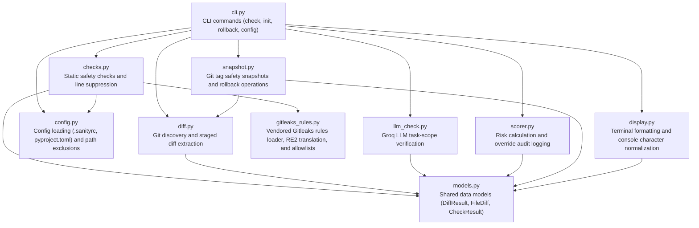
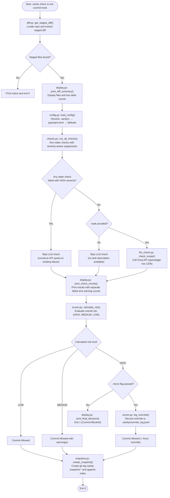
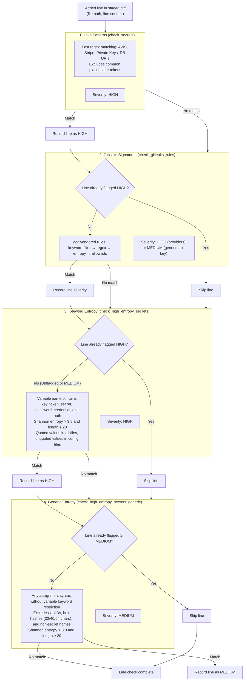
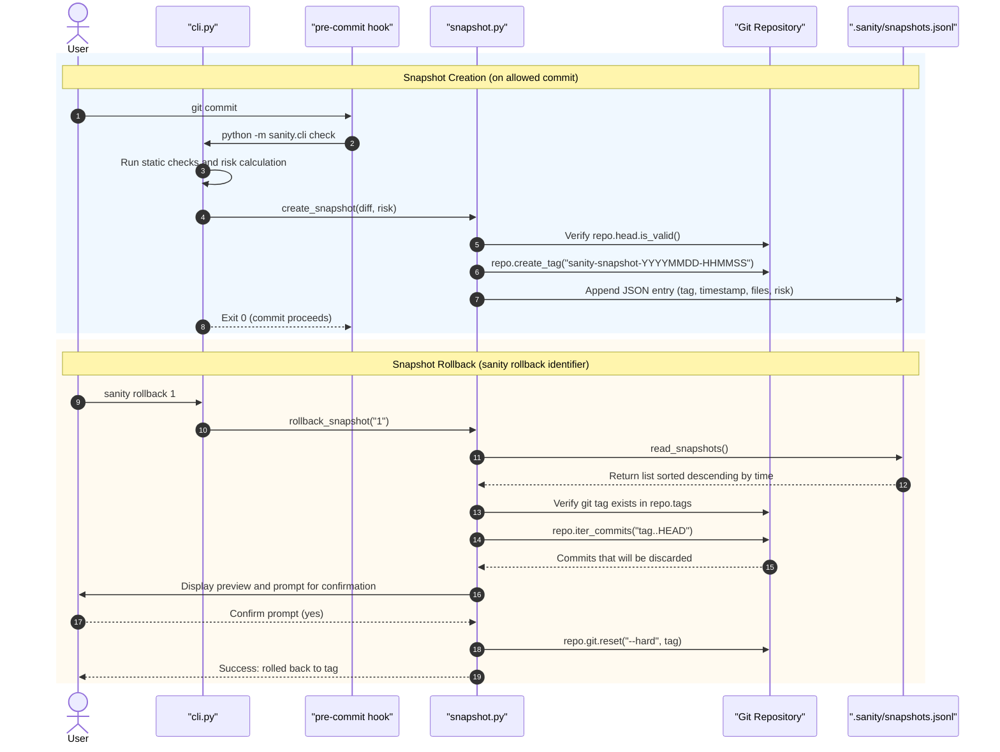

# Sanity - Pre-commit Risk Checker
[](https://pypi.org/project/sanity-guard/)

Sanity acts as a pre-commit risk checker for AI-generated code changes. It evaluates code additions for dangerous statements, exposed secrets, and scope drift, and safely blocks risky commits.

## Safety Nets & Snapshots
Whenever a commit is allowed (whether deemed safe, or overridden via `--force`), Sanity automatically creates a lightweight local git tag (e.g. `sanity-snapshot-20260823-153012`) pointing to the commit *before* the new changes. This ensures that even if an AI agent makes a destructive commit, you can easily view your history and roll it back using `sanity rollback <number>`.

> **Note**: `sanity-snapshot-*` tags are intended strictly as local safety nets. Git naturally keeps tags local during a standard `git push`, so they won't clutter your remote repository unless you explicitly run `git push --tags`.

## What it catches

- **Leaked secrets** -- multi-layer detection: community-maintained Gitleaks rules, known format patterns, and Shannon entropy fallbacks
- **Mass deletions** -- flags commits that delete far more code than they add
- **Dangerous commands** -- catches `rm -rf`, `DROP TABLE`, force-push scripts
- **Scope creep** -- uses LLM analysis to verify changes match the stated task
- **Auto-snapshots** -- every commit gets a safety snapshot for easy rollback

## Architecture

> **Note**: The architecture diagrams below use Mermaid syntax and render natively on GitHub. On platforms that do not render Mermaid (such as PyPI), they appear as readable code blocks.

### 1. Module Map

The Sanity codebase is organized into modular components with explicit separation of responsibilities:



- `cli.py`: Click CLI entry points for `sanity check`, `sanity init`, `sanity rollback`, and `sanity config`.
- `diff.py`: Locates the enclosing Git repository, captures `--cached` diffs, and constructs structured `DiffResult` models (with initial-commit fallback when HEAD does not yet exist).
- `config.py`: Resolves project settings hierarchically (`.sanityrc` / `.sanityrc.toml`, then `pyproject.toml [tool.sanity]`, then defaults), matching file exclusion patterns.
- `checks.py`: Orchestrates the static inspection engine across deletion ratios, built-in credentials, vendored rules, entropy tiers, and dangerous commands, implementing severity-aware line suppression.
- `gitleaks_rules.py`: Loads vendored Gitleaks rules from TOML, translates Go RE2 regular expressions to Python `re` syntax, and compiles global and rule-level allowlists with in-memory caching.
- `llm_check.py`: Summarizes diffs, loads API credentials with environment precedence, and queries Groq (`openai/gpt-oss-120b`) for task-scope verification.
- `scorer.py`: Computes overall risk (`HIGH`, `MEDIUM`, `LOW`) from check results and logs forced overrides to `.sanity/override_log.jsonl`.
- `snapshot.py`: Creates local `sanity-snapshot-*` Git tags pointing to HEAD on allowed commits, maintains the `.sanity/snapshots.jsonl` index, and executes hard rollbacks.
- `display.py`: Renders diff statistics, formats static check results, and normalizes typographic unicode characters to ASCII for terminal compatibility.
- `models.py`: Dataclass definitions (`FileDiff`, `DiffResult`, `CheckResult`) passed across components.

### 2. `sanity check` Execution Flow

The `sanity check` command processes staged modifications through sequential phases:



### 3. Secret Detection Layering

Sanity executes secret checks in a fixed pipeline with severity-aware suppression so that high-confidence findings take precedence while preventing duplicate noise on the same line:



### 4. Snapshot and Rollback Sequence

Safety snapshots are automatically captured before allowed commits, enabling instant rollbacks:



### 5. Check Suite Reference

| Check Name | Module | What It Catches | Severity | Failure & Skip Behavior |
|---|---|---|---|---|
| `deletion_ratio` | `checks.py` | Commits that delete code in excess of threshold (default 3.0x: `deleted / added > 3.0`), or pure deletion commits (`deleted > 0` with 0 added lines). | `HIGH` | Blocks commit unless `--force` is used. Skips if no lines were added or deleted. |
| `secret_detection` | `checks.py` | Fast regex matches for core credentials: AWS access/secret keys, Stripe API keys, private key headers, generic API keys/secrets/tokens/passwords, and database connection URIs. Excludes placeholder values (`your_`, `dummy`, `changeme`, repeated single characters). | `HIGH` | Blocks commit unless `--force` is used. |
| `gitleaks_rules` | `checks.py` | 222 vendored Gitleaks signatures for third-party service providers (GitHub, Slack, OpenAI, AWS, etc.) evaluated with keyword pre-filters, regexes, Shannon entropy thresholds, and allowlists. | `HIGH` (providers)<br/>`MEDIUM` (`generic-api-key`) | `HIGH` blocks commit; `MEDIUM` emits a warning and allows commit. Skips lines already flagged `HIGH`. |
| `high_entropy_secrets` | `checks.py` | Assignment-shaped lines where the variable name contains a suspicious keyword (`key`, `token`, `secret`, `password`, `credential`, `api`, `auth`) with Shannon entropy > 3.8 and length &ge; 20 chars. Supports quoted values in all files and unquoted values in config files (`.env`, `.yaml`, `.ini`, etc.). | `HIGH` | Blocks commit unless `--force` is used. Skips lines already flagged `HIGH`. |
| `high_entropy_secrets_generic` | `checks.py` | Assignment-shaped lines with Shannon entropy > 3.8 and length &ge; 20 chars without variable keyword restrictions. Excludes UUIDs, MD5/SHA1/SHA256 hex hashes, and non-secret variable identifiers (`id`, `hash`, `checksum`, `slug`, `path`, etc.). | `MEDIUM` | Emits a warning and allows commit. Skips lines already flagged `HIGH` or `MEDIUM`. |
| `dangerous_commands` | `checks.py` | Destructive commands in added lines: `rm -rf`, `DROP TABLE`, `DELETE FROM ...` without `WHERE` (scanning forward up to 10 context lines for `WHERE` or `;`), `TRUNCATE TABLE`, `git push --force`, `os.remove()`, and `shutil.rmtree()`. | `HIGH` | Blocks commit unless `--force` is used. |
| `scope_verification` | `llm_check.py` | Modifications that do not match the task description provided via `--task`, evaluated by Groq LLM (`openai/gpt-oss-120b`). | `HIGH` on `NO`<br/>`MEDIUM` on `UNSURE` or empty response<br/>`LOW` on `YES` | Skipped if `--task` is omitted, if any static check failed `HIGH`, if `GROQ_API_KEY` is missing, or if an API exception occurs. Never blocks on network failure. |

### 6. Design Decisions

The implementation follows specific operational constraints derived directly from code behavior:

1. **Static checks run before LLM verification**: All static checks execute locally with zero network latency. If any static check returns `HIGH` severity, the LLM scope check is skipped entirely, conserving the free-tier Groq API token budget when a commit is already blocked.
2. **LLM scope check requires manual `--task`**: Git's `pre-commit` hook stage executes before the user enters a commit message. Because no commit message exists yet during automated pre-commit execution, scope verification is skipped unless explicitly supplied via `sanity check --task "..."`.
3. **Severity-aware line suppression**: Downstream secret checks only skip lines flagged by earlier checks if the earlier check flagged the line at equal or higher severity (`HIGH >= HIGH`, `HIGH >= MEDIUM`). This prevents a lower-severity finding (such as `generic-api-key` `MEDIUM`) from masking a `HIGH` entropy finding on the same line, while preventing stacked duplicate warnings for the same credential.
4. **Vendored and pinned provider rules**: The 222 Gitleaks rules are vendored directly in `src/sanity/data/gitleaks_rules.toml` and loaded once into an in-memory cache at runtime. This eliminates external network dependencies, prevents unexpected upstream breaking changes, and keeps scans deterministic.
5. **Non-blocking LLM failures**: Missing or invalid `GROQ_API_KEY`, API timeouts, network disconnections, and malformed model outputs are treated as warnings or skips (`MEDIUM` or omitted from results). LLM failures never block a commit or crash the tool.
6. **Local safety net tags**: Git snapshot tags (`sanity-snapshot-*`) point to the commit state immediately *before* allowed changes. Git does not push local tags by default during `git push`, keeping remote repositories clean while guaranteeing an instant local rollback target via `sanity rollback`.

## Quick start

```bash
# Install
pip install sanity-guard
```

> **Windows users**: if the `sanity` command isn't recognized after installing, pip may have installed it to a user Scripts directory that isn't on your PATH (pip's install output will show a warning with the exact path if this happens). Either run commands as `python -m sanity <command>` instead, or add that Scripts directory to your PATH.

```bash
# Set up your Groq API key (free tier)
# Set via environment variable (takes precedence) or in a .env file in cwd or git repo root:
export GROQ_API_KEY="your-api-key"
# Or:
cp .env.example .env
# Edit .env with your key from https://console.groq.com

# Install the pre-commit hook in your repo
sanity init

# Manually check staged changes
sanity check

# Rollback to a previous safe state
sanity rollback
```

## Commands

| Command | Description |
|---------|-------------|
| `sanity init` | Install pre-commit hook in current repo |
| `sanity check [--task "desc"] [--force]` | Run safety checks on staged diff |
| `sanity rollback [id] [--list] [--prune]` | Revert to a previous safe snapshot |
| `sanity config [--set key=val]` | Configure thresholds and toggle checks |

## How This Was Tested

- Stripe API keys were initially undetected by secret_detection -- found via manual adversarial testing, fixed by adding a dedicated regex pattern plus a generic Shannon-entropy fallback check for unknown/unlisted services (Firebase, Twilio, SendGrid, etc.)
- Multi-line DELETE FROM / WHERE statements bypassed dangerous_commands detection -- fixed by extending the check to scan forward across diff hunk context for a WHERE clause on a following line
- The LLM scope check intermittently returned empty responses -- root cause was the reasoning model (openai/gpt-oss-120b) consuming its entire max_tokens budget on internal reasoning before reaching a final answer; fixed by raising the token limit
- A test-isolation bug was found where running the test suite created real git tags and wrote to this project's actual .sanity/snapshots.jsonl file -- traced to CLI-level integration tests that weren't mocking snapshot creation; fixed by auditing and patching every test that invokes the CLI end-to-end
- GitHub's own secret-scanning push protection flagged realistic-looking fake keys in test fixtures when first pushing to GitHub -- resolved by rewriting fixtures to use obviously non-functional placeholder strings
- End-to-end verification: a real `git commit` containing a fake AWS key, run through the actual installed pre-commit hook (via `sanity init`), was correctly blocked by git itself -- not just `sanity check` reporting the right result when run manually
- The published PyPI package was verified by installing it in a completely fresh virtual environment with no access to the source repo, then confirming `sanity init` and a real blocked commit both worked correctly

## Known Limitations

**Go RE2 to Python regex compatibility.** Gitleaks rules are authored in Go RE2 regex syntax. Sanity translates Go-specific syntax (such as mid-pattern inline flags `(?i)` scoped to `(?i:...)`, flag resets, and end-of-text `\z` to `\Z`) so patterns compile accurately under Python's standard `re` module without altering matching behavior. All 222 rules from the vendored Gitleaks configuration are active (0 skipped). Any synthetic or future uncompilable rules are safely skipped without halting or crashing the tool.

**Detection is assignment-pattern-based, not content-based.** Both check_secrets and check_high_entropy_secrets only match code shaped like `variable_name = "value"` (or similar `:`/`=` syntax) where the variable name contains a suspicious keyword (key, token, secret, password, credential, api, auth). A secret-shaped string appearing any other way -- a bare string literal, a function call argument, text split across concatenated strings, embedded in a URL, or in a config format the regex doesn't anticipate -- will not be flagged, regardless of how random or sensitive it looks.

**Length and entropy thresholds create edge cases at the margins.** Known-pattern detection requires 16+ characters; the entropy fallback requires 20+ characters and a Shannon entropy above 3.8 bits/char. Very short secrets, or longer strings with heavy character repetition (lower measured entropy despite looking non-random), can fall under both thresholds. Confirmed during testing: a 37-character non-dictionary string scored 3.44 bits/char (just under threshold) due to repeated letters, while an equally long base64-style string scored 4.57 bits/char and was correctly caught.

**Scope verification requires manual task input.** The LLM scope check requires an explicit `--task` flag to run. Because git's `pre-commit` stage executes before the commit message is created, Sanity cannot automatically pull the commit message during a standard `git commit` -- the scope check will simply be skipped unless manually invoked.

**Concatenated strings can evade detection.** A secret split across concatenated string literals (`secret = "abc" + "def"`) can evade detection if each segment individually falls under the length threshold.

**Secrets passed as function arguments are not detected.** Secrets passed directly into function or method calls (such as `connect(api_key="...")` or `authenticate("secret-token")`) do not match assignment patterns and are not flagged by regex or entropy checks unless matched by a format-specific Gitleaks rule.

**Default exclusions omit test files and docs.** By default, files matching `test_*.py`, `*_test.py`, `tests/**`, `README*`, `*.md`, `docs/**`, `CHANGELOG*`, `examples/**` and `.sanity/**` are excluded from all checks, meaning secrets committed to test suites, fixtures, or markdown documentation are not scanned unless configured otherwise.

**`# sanity: ignore` bypasses every check.** Placing `# sanity: ignore` on any line suppresses all static safety checks for that line.

**Manual check runs create snapshot tags.** Running `sanity check` manually creates a safety snapshot git tag each time the staged changes are allowed (or forced), just like an automated pre-commit hook run.

This tool is a heuristic safety net designed to catch common, careless mistakes -- it does not replace purpose-built secret-scanning tools or human code review.

## Attribution & Licenses

Sanity vendors community-maintained secret detection rules from the [Gitleaks](https://github.com/gitleaks/gitleaks) project:
- **Gitleaks**: Licensed under the MIT License, Copyright (c) 2019 Zachary Rice.
- The pinned rules file (`gitleaks_rules.toml`) and the license text (`GITLEAKS_LICENSE`) are packaged in `src/sanity/data/`.

## Requirements

- Python 3.11+
- Git
- Groq API key (free, no credit card needed)

## Development

Local development and publishing instructions for contributors:

```bash
# Local editable install
pip install -e .

# Build the package
python -m build

# Validate metadata
twine check dist/*

# Publish to PyPI
twine upload dist/*
```
